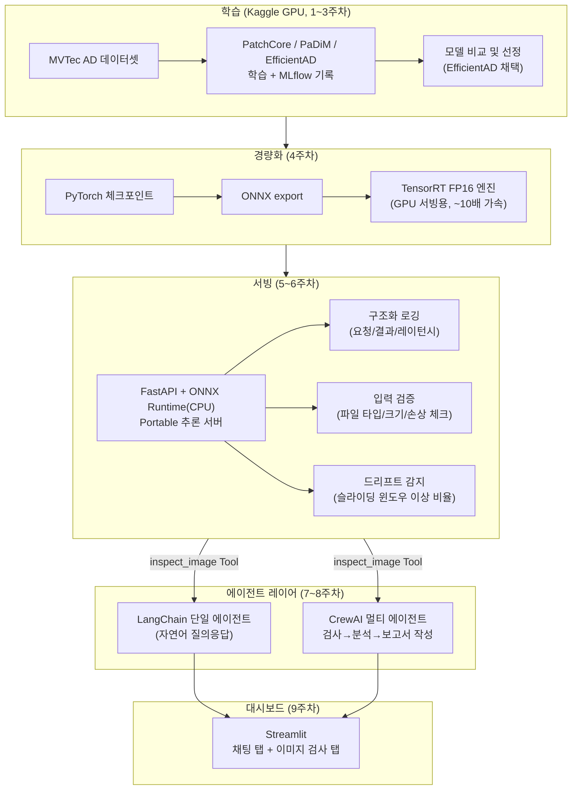

# Industrial Anomaly Detection

제조 공정에서 촬영된 제품 이미지를 보고 정상/불량을 판별하는 이상 탐지(Anomaly Detection) 시스템. 모델 학습부터 경량화, 로컬 서빙, 모니터링, 자연어 에이전트 레이어까지 end-to-end로 구현했다.

데이터셋: [MVTec AD](https://www.mvtec.com/company/research/datasets/mvtec-ad) (bottle, cable, capsule, hazelnut, screw 카테고리)

## 아키텍처



| 레이어 | 기술 스택 | 주차 |
|---|---|---|
| 학습 | PyTorch, anomalib, MLflow | 1~3주차 |
| 경량화 | ONNX, TensorRT FP16 | 4주차 |
| 서빙 | FastAPI, ONNX Runtime (CPU) | 5주차 |
| 모니터링 | 구조화 로깅, 입력 검증, 드리프트 감지 | 6주차 |
| 단일 에이전트 | LangChain 1.x (`create_agent`) | 7주차 |
| 멀티 에이전트 | CrewAI (검사/분석/보고서 3개 역할) | 8주차 |
| 대시보드 | Streamlit | 9주차 |

## 핵심 결과

5개 카테고리 × 3개 모델 비교 실험 결과 (3주차, image AUROC 기준):

| category | PatchCore | PaDiM | EfficientAD (5000 step) |
|---|---|---|---|
| bottle | 1.000 | 0.997 | 1.000 |
| cable | 0.988 | 0.859 | 0.950 |
| capsule | 0.991 | 0.878 | 0.706 |
| hazelnut | 1.000 | 0.650 | 0.843 |
| screw | 0.966 | 0.776 | 0.766 |

capsule/hazelnut/screw에서 EfficientAD 성능이 떨어지는 것을 발견 → `max_steps`를 5000→15000으로 올려 재학습한 결과 capsule 0.706→0.878(+17.3%p), hazelnut 0.843→0.906(+6.3%p)로 개선 (under-training이 원인이었음을 확인). 자세한 내용은 [`scripts/docs/week9_decisions.md`](scripts/docs/week9_decisions.md) 참고.

최종적으로 **PatchCore가 정확도는 더 높았지만, EfficientAD를 배포 모델로 선택**했다. 이유는 PatchCore가 memory bank(k-NN 검색) 기반이라 ONNX/TensorRT 같은 정적 그래프로 export하기 어려운 반면, EfficientAD는 순수 feed-forward 구조라 경량화·엣지 배포에 적합했기 때문이다.

경량화 효과 (bottle/capsule, 4주차):

| category | PyTorch 레이턴시 | TensorRT FP16 레이턴시 | speedup | image AUROC (PyTorch → TRT) |
|---|---|---|---|---|
| bottle | 40.56ms | 4.12ms | 9.86x | 1.0000 → 1.0000 |
| capsule | 40.75ms | 4.19ms | 9.73x | 0.9039 → 0.9039 |

## 실세계 조건 강건성 검증

공개 데이터셋의 AUROC만으로는 실제 라인에서의 운영 품질을 알 수 없어서, 로컬 서빙 엔드포인트(`/inspect`)에 테스트 이미지를 전송해 수집한 anomaly score로 세 가지를 추가 검증했다. 코드: [`evaluation/robustness_eval.py`](evaluation/robustness_eval.py), 입력 데이터: [`evaluation/results/`](evaluation/results/)

**1) 클래스 불균형 시뮬레이션** (불량 비율을 바꿔 500장씩 20회 리샘플링, 평균)

| 불량 비율 | bottle Precision | capsule 5000 step Precision | capsule 15000 step Precision |
|---|---|---|---|
| 50% | 1.000 | 0.535 | 0.511 |
| 10% | 1.000 | 0.112 | 0.104 |
| 5% | 1.000 | 0.057 | 0.052 |
| 1% | 1.000 | 0.011 | 0.010 |

AUROC는 불량 비율과 거의 무관하게 유지됐지만(capsule 15000 step 기준 0.87~0.90), 경계 사례가 많은 capsule은 불량 비율이 실제 라인 수준(1%)으로 내려가자 Precision이 0.01 수준까지 떨어졌다. **순위 기반 지표(AUROC)만으로는 오탐 비용을 판단할 수 없다**는 것을 확인했다.

**2) 라벨 노이즈 강건성** (테스트 라벨의 일부를 무작위로 뒤집었을 때 측정 AUROC)

| 노이즈 비율 | bottle | capsule 15000 step |
|---|---|---|
| 0% | 1.000 | 0.880 |
| 5% | 0.926 | 0.820 |
| 10% | 0.856 | 0.740 |
| 20% | 0.736 | 0.660 |

검사 라벨이 20% 틀려 있으면 같은 모델도 0.1~0.26 낮게 평가된다. 현장 데이터로 모델을 비교할 때는 라벨 품질부터 확인해야 한다.

**3) 임계값 재보정** (고정 임계값 0.5 vs F1 최적 임계값)

| 체크포인트 | AUROC | 고정 0.5 Precision / Recall | 재보정 Precision / Recall |
|---|---|---|---|
| capsule 5000 step (under-trained) | 0.682 | 0.844 / 0.991 | 0.844 / 0.991 (변화 없음) |
| capsule 15000 step (재학습) | 0.880 | 0.832 / 1.000 | **0.872 / 1.000** |

같은 재보정 기법이 학습이 부족한 모델에서는 효과가 없었고, 충분히 학습된 모델에서만 Recall을 유지하면서 Precision을 높였다. 후처리보다 모델 자체의 분리 성능이 먼저라는 근거다.

```bash
python evaluation/robustness_eval.py
```

> 리샘플링 기반이라 pandas/scikit-learn 버전에 따라 소수점 셋째 자리가 조금 달라질 수 있다 (위 수치: pandas 3.0, scikit-learn 1.9).

## 빠른 시작

### 1. 모델 학습 (Kaggle/GPU 환경)

```bash
python scripts/train.py --root /path/to/mvtec_ad --category bottle --model efficientad --max_steps 5000
```

### 2. 모델 준비 (ONNX)

모델 파일(`*.onnx`)은 용량 때문에 저장소에 포함하지 않았다. 학습한 체크포인트를 ONNX로 export한 뒤 `serving/models/<category>_model.onnx` 이름으로 넣는다.

```bash
python scripts/export_tensorrt.py --data_root /path/to/mvtec_ad --export_dir exported \
    --ckpt bottle=/path/to/bottle/model.ckpt --ckpt capsule=/path/to/capsule/model.ckpt
mkdir -p serving/models
cp exported/bottle/weights/onnx/model.onnx  serving/models/bottle_model.onnx
cp exported/capsule/weights/onnx/model.onnx serving/models/capsule_model.onnx
```

> TensorRT가 없는 환경에서는 anomalib `Engine().export(model, ExportType.ONNX, export_root=...)`만 실행해도 된다. export 경로는 anomalib 버전에 따라 다를 수 있다.

### 3. 로컬 서빙 (CPU, ONNX Runtime)

```bash
cd serving
pip install -r requirements.txt
uvicorn app:app --reload --port 8000
# http://127.0.0.1:8000/docs 에서 /inspect, /drift-status 테스트
curl -F "file=@/path/to/image.png" "http://127.0.0.1:8000/inspect?category=capsule"
```

- 서버는 `serving/models/` 안의 모델을 카테고리별로 모두 로드한다. `category`를 생략하면 bottle을 쓴다.
- 최종 판정(`is_anomaly`)은 ONNX에 내장된 기본 임계값이 아니라 강건성 검증에서 구한 **카테고리별 캘리브레이션 임계값**(`serving/inference.py`의 `CALIBRATED_THRESHOLDS`, capsule 0.504)으로 계산한다. 응답에 적용된 `threshold`가 함께 반환된다.
- 드리프트 감지 윈도우도 카테고리별로 따로 관리한다 (`/drift-status?category=capsule`).
- Docker: `docker build -t anomaly-api serving/ && docker run -p 8000:8000 anomaly-api` (빌드 전 `serving/models/` 준비 필요)

### 4. 자연어 에이전트 (단일)

에이전트·멀티 에이전트·대시보드의 이미지 검사 도구는 모델을 직접 로드하지 않고 3번의 추론 서버(`/inspect`)를 호출한다. 그래서 에이전트 경유 요청도 입력 검증, 구조화 로깅, 드리프트 감지, 캘리브레이션 임계값이 똑같이 적용된다. **서버를 먼저 실행한 상태**에서 사용한다 (주소 변경: 환경변수 `ANOMALY_API_URL`).

```bash
cd serving/agent
pip install -r ../requirements.txt -r requirements-agent.txt
python agent.py
```

### 5. 멀티 에이전트 파이프라인 (검사 → 분석 → 보고서)

```bash
cd serving/crew
pip install -r ../requirements.txt -r requirements-crew.txt
# 검사할 이미지 경로를 인자로 넘긴다 (예: MVTec AD의 bottle/test/broken_large/000.png)
python crew_pipeline.py /path/to/mvtec_ad/bottle/test/broken_large/000.png
# 카테고리 지정 (기본: bottle)
python crew_pipeline.py /path/to/mvtec_ad/capsule/test/crack/000.png capsule
```

### 6. 통합 대시보드

```bash
cd serving/dashboard
pip install -r ../requirements.txt -r ../agent/requirements-agent.txt -r ../crew/requirements-crew.txt -r requirements-dashboard.txt
streamlit run dashboard.py
```

## 프로젝트 문서

주차별 트러블슈팅 기록과 의사결정 과정은 [`scripts/docs/`](scripts/docs/)에 정리되어 있다.

- [`week4_tensorrt_debugging.md`](scripts/docs/week4_tensorrt_debugging.md) — TensorRT FP16 변환 트러블슈팅
- [`week5_local_deployment_debugging.md`](scripts/docs/week5_local_deployment_debugging.md) — 로컬 배포, 전처리 버그, 드리프트 감지 테스트
- [`week6_monitoring_stability.md`](scripts/docs/week6_monitoring_stability.md) — 로깅/입력 검증/드리프트 감지
- [`week7_langchain_agent.md`](scripts/docs/week7_langchain_agent.md) — LangChain 단일 에이전트
- [`week8_crewai_pipeline.md`](scripts/docs/week8_crewai_pipeline.md) — CrewAI 멀티 에이전트 파이프라인
- [`week9_decisions.md`](scripts/docs/week9_decisions.md) — 주요 의사결정 과정 종합 (모델 선정, under-training 발견, 설계 트레이드오프)
