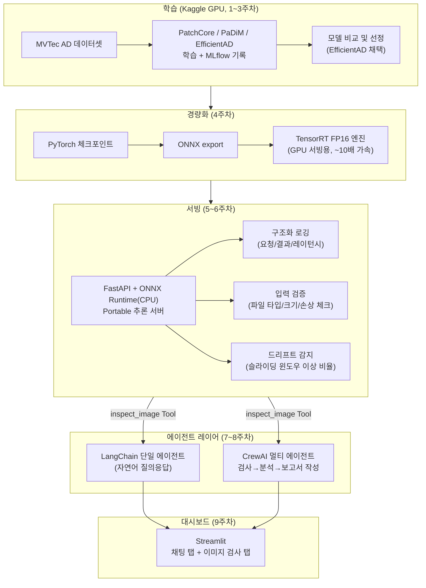

# Industrial Anomaly Detection

제조 공정에서 촬영된 제품 이미지를 보고 정상/불량을 판별하는 이상 탐지(Anomaly Detection) 시스템. 모델 학습부터 경량화, 로컬 서빙, 모니터링, 자연어 에이전트 레이어까지 end-to-end로 구현했다.

데이터셋: [MVTec AD](https://www.mvtec.com/company/research/datasets/mvtec-ad) (bottle, cable, capsule, hazelnut, screw 카테고리)

## 아키텍처



| 레이어 | 기술 스택 | 주차 |
|---|---|---|
| 학습 | PyTorch, anomalib, MLflow | 1~3주차 |
| 경량화 | ONNX, TensorRT FP16 | 4주차 |
| 서빙 | FastAPI, ONNX Runtime (CPU) | 5주차 |
| 모니터링 | 구조화 로깅, 입력 검증, 드리프트 감지 | 6주차 |
| 단일 에이전트 | LangChain 1.x (`create_agent`) | 7주차 |
| 멀티 에이전트 | CrewAI (검사/분석/보고서 3개 역할) | 8주차 |
| 대시보드 | Streamlit | 9주차 |

## 핵심 결과

5개 카테고리 × 3개 모델 비교 실험 결과 (3주차, image AUROC 기준):

| category | PatchCore | PaDiM | EfficientAD (5000 step) |
|---|---|---|---|
| bottle | 1.000 | 0.997 | 1.000 |
| cable | 0.988 | 0.859 | 0.950 |
| capsule | 0.991 | 0.878 | 0.706 |
| hazelnut | 1.000 | 0.650 | 0.843 |
| screw | 0.966 | 0.776 | 0.766 |

capsule/hazelnut/screw에서 EfficientAD 성능이 떨어지는 것을 발견 → `max_steps`를 5000→15000으로 올려 재학습한 결과 capsule 0.706→0.878(+17.3%p), hazelnut 0.843→0.906(+6.3%p)로 개선 (under-training이 원인이었음을 확인). 자세한 내용은 [`scripts/docs/week9_decisions.md`](scripts/docs/week9_decisions.md) 참고.

최종적으로 **PatchCore가 정확도는 더 높았지만, EfficientAD를 배포 모델로 선택**했다. 이유는 PatchCore가 memory bank(k-NN 검색) 기반이라 ONNX/TensorRT 같은 정적 그래프로 export하기 어려운 반면, EfficientAD는 순수 feed-forward 구조라 경량화·엣지 배포에 적합했기 때문이다.

경량화 효과 (bottle/capsule, 4주차):

| category | PyTorch 레이턴시 | TensorRT FP16 레이턴시 | speedup | image AUROC (PyTorch → TRT) |
|---|---|---|---|---|
| bottle | 40.56ms | 4.12ms | 9.86x | 1.0000 → 1.0000 |
| capsule | 40.75ms | 4.19ms | 9.73x | 0.9039 → 0.9039 |

## 빠른 시작

### 1. 모델 학습 (Kaggle/GPU 환경)

```bash
python scripts/train.py --root /path/to/mvtec_ad --category bottle --model efficientad --max_steps 5000
```

### 2. 로컬 서빙 (CPU, ONNX Runtime)

```bash
cd serving
pip install -r requirements.txt
uvicorn app:app --reload --port 8000
# http://127.0.0.1:8000/docs 에서 /inspect, /drift-status 테스트
```

### 3. 자연어 에이전트 (단일)

```bash
cd serving/agent
pip install -r ../requirements.txt -r requirements-agent.txt
python agent.py
```

### 4. 멀티 에이전트 파이프라인 (검사 → 분석 → 보고서)

```bash
cd serving/crew
pip install -r ../requirements.txt -r requirements-crew.txt
python crew_pipeline.py ../bottle_bad.png
```

### 5. 통합 대시보드

```bash
cd serving/dashboard
pip install -r ../requirements.txt -r ../agent/requirements-agent.txt -r ../crew/requirements-crew.txt -r requirements-dashboard.txt
streamlit run dashboard.py
```

## 프로젝트 문서

주차별 트러블슈팅 기록과 의사결정 과정은 [`scripts/docs/`](scripts/docs/)에 정리되어 있다.

- [`week4_tensorrt_debugging.md`](scripts/docs/week4_tensorrt_debugging.md) — TensorRT FP16 변환 트러블슈팅
- [`week5_local_deployment_debugging.md`](scripts/docs/week5_local_deployment_debugging.md) — 로컬 배포, 전처리 버그, 드리프트 감지 테스트
- [`week6_monitoring_stability.md`](scripts/docs/week6_monitoring_stability.md) — 로깅/입력 검증/드리프트 감지
- [`week7_langchain_agent.md`](scripts/docs/week7_langchain_agent.md) — LangChain 단일 에이전트
- [`week8_crewai_pipeline.md`](scripts/docs/week8_crewai_pipeline.md) — CrewAI 멀티 에이전트 파이프라인
- [`week9_decisions.md`](scripts/docs/week9_decisions.md) — 주요 의사결정 과정 종합 (모델 선정, under-training 발견, 설계 트레이드오프)
